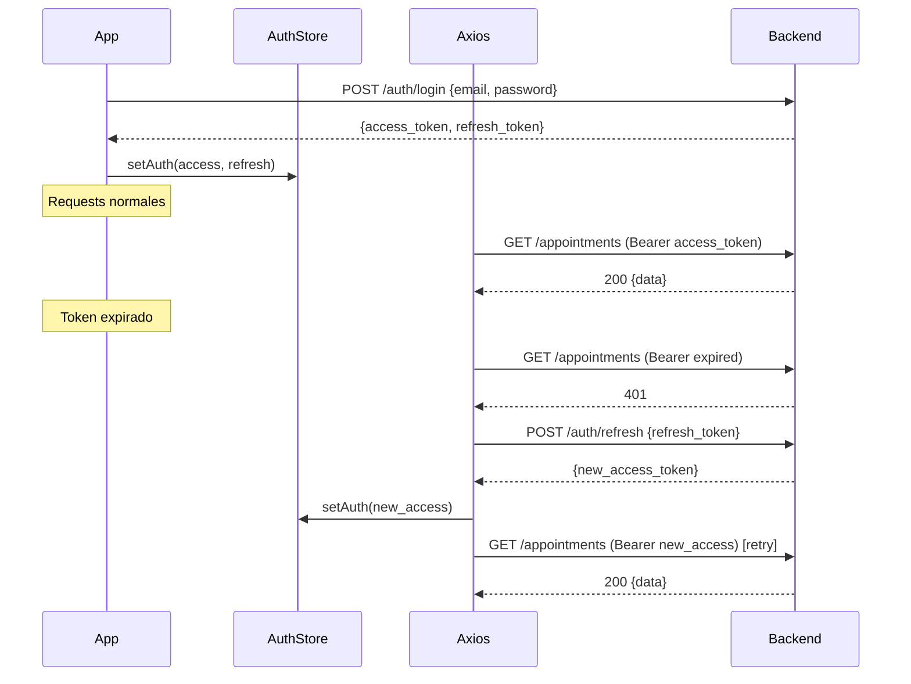

# Backend Auth Flow — Helu

## Endpoints del backend

| Método | Endpoint | Descripción | Response |
|---|---|---|---|
| POST | `/api/v1/auth/signup` | Registrar usuario | `{ message, user: { id, email } }` |
| POST | `/api/v1/auth/login` | Login con email/password | `{ access_token, refresh_token, token_type }` |
| POST | `/api/v1/auth/refresh` | Renovar access token | `{ access_token, refresh_token, token_type }` |

---

## Schemas Zod (frontend)

```ts
// packages/api/src/schemas/auth.schema.ts
import { z } from "zod";

export const LoginRequestSchema = z.object({
  email: z.string().email("Email inválido"),
  password: z.string().min(6, "Mínimo 6 caracteres"),
});

export const SignupRequestSchema = z.object({
  email: z.string().email("Email inválido"),
  password: z.string().min(8, "Mínimo 8 caracteres"),
  referralCode: z.string().optional(),
});

export const TokenResponseSchema = z.object({
  access_token: z.string(),
  refresh_token: z.string(),
  token_type: z.literal("bearer"),
});

export type LoginRequest = z.infer<typeof LoginRequestSchema>;
export type SignupRequest = z.infer<typeof SignupRequestSchema>;
export type TokenResponse = z.infer<typeof TokenResponseSchema>;
```

---

## API endpoints (frontend)

```ts
// packages/api/src/endpoints/auth.api.ts
import { apiClient } from "../client";
import { TokenResponseSchema, type LoginRequest, type SignupRequest } from "../schemas/auth.schema";

export async function login(credentials: LoginRequest) {
  const { data } = await apiClient.post("/auth/login", credentials);
  return TokenResponseSchema.parse(data);
}

export async function signup(userData: SignupRequest) {
  const { data } = await apiClient.post("/auth/signup", userData);
  return data;
}

export async function refreshAccessToken(refreshToken: string) {
  const { data } = await apiClient.post("/auth/refresh", {
    refresh_token: refreshToken,
  });
  return TokenResponseSchema.parse(data);
}
```

---

## Cliente Axios con auto-refresh

```ts
// packages/api/src/client.ts
import axios, { type AxiosError } from "axios";
import { env } from "@helu/config";
import { useAuthStore } from "@helu/stores";
import { parseApiError } from "./errors";

export const apiClient = axios.create({
  baseURL: env.API_URL + "/api/v1",
  timeout: 15_000,
  headers: { "Content-Type": "application/json" },
});

// Request: adjuntar token + contexto de delegación
apiClient.interceptors.request.use((config) => {
  const { token, activePatientId } = useAuthStore.getState();

  if (token) {
    config.headers.Authorization = `Bearer ${token}`;
  }
  // Delegación: si el manager está operando como un paciente
  if (activePatientId) {
    config.headers["X-Patient-Context"] = activePatientId;
  }
  return config;
});

// Response: auto-refresh en 401
let isRefreshing = false;
let failedQueue: Array<{ resolve: Function; reject: Function }> = [];

const processQueue = (error: any, token: string | null = null) => {
  failedQueue.forEach((p) => (error ? p.reject(error) : p.resolve(token)));
  failedQueue = [];
};

apiClient.interceptors.response.use(
  (response) => response,
  async (error: AxiosError) => {
    const originalRequest = error.config as any;

    // Si es 401 y no es el propio refresh endpoint
    if (error.response?.status === 401 && !originalRequest._retry) {
      if (isRefreshing) {
        // Encolar el request hasta que el refresh termine
        return new Promise((resolve, reject) => {
          failedQueue.push({ resolve, reject });
        }).then((token) => {
          originalRequest.headers.Authorization = `Bearer ${token}`;
          return apiClient(originalRequest);
        });
      }

      originalRequest._retry = true;
      isRefreshing = true;

      try {
        const { refreshToken } = useAuthStore.getState();
        if (!refreshToken) throw new Error("No refresh token");

        const { data } = await axios.post(
          `${env.API_URL}/api/v1/auth/refresh`,
          { refresh_token: refreshToken }
        );

        const newToken = data.access_token;
        useAuthStore.getState().setAuth(newToken, data.refresh_token);
        processQueue(null, newToken);

        originalRequest.headers.Authorization = `Bearer ${newToken}`;
        return apiClient(originalRequest);
      } catch (refreshError) {
        processQueue(refreshError, null);
        useAuthStore.getState().logout();
        return Promise.reject(refreshError);
      } finally {
        isRefreshing = false;
      }
    }

    return Promise.reject(parseApiError(error));
  }
);
```

---

## Auth Store con refresh token

```ts
// packages/stores/src/authStore.ts
import { create } from "zustand";
import { persist, createJSONStorage } from "zustand/middleware";
import { storage } from "./storage";

type User = { id: string; name: string; email: string };

type AuthState = {
  token: string | null;
  refreshToken: string | null;
  user: User | null;
  isHydrated: boolean;
  // Delegación
  activePatientId: string | null;
  isManaging: boolean;
  // Acciones
  setAuth: (token: string, refreshToken: string) => void;
  setUser: (user: User) => void;
  setPatientContext: (patientId: string | null) => void;
  logout: () => void;
  setHydrated: () => void;
};

export const useAuthStore = create<AuthState>()(
  persist(
    (set) => ({
      token: null,
      refreshToken: null,
      user: null,
      isHydrated: false,
      activePatientId: null,
      isManaging: false,
      setAuth: (token, refreshToken) => set({ token, refreshToken }),
      setUser: (user) => set({ user }),
      setPatientContext: (patientId) =>
        set({ activePatientId: patientId, isManaging: !!patientId }),
      logout: () =>
        set({ token: null, refreshToken: null, user: null, activePatientId: null, isManaging: false }),
      setHydrated: () => set({ isHydrated: true }),
    }),
    {
      name: "auth-store",
      storage: createJSONStorage(() => storage),
      partialize: (s) => ({ token: s.token, refreshToken: s.refreshToken, user: s.user }),
      onRehydrateStorage: () => (state) => state?.setHydrated(),
    }
  )
);

export const useToken = () => useAuthStore((s) => s.token);
export const useUser = () => useAuthStore((s) => s.user);
export const useIsAuth = () => useAuthStore((s) => !!s.token);
export const useIsManaging = () => useAuthStore((s) => s.isManaging);
```

---

## Login hook

```ts
// packages/features/src/auth/hooks/useLogin.ts
import { useMutation } from "@tanstack/react-query";
import { login } from "@helu/api";
import { useAuthStore } from "@helu/stores";
import type { LoginRequest } from "@helu/api";

export function useLogin(onSuccess?: () => void) {
  const setAuth = useAuthStore((s) => s.setAuth);

  return useMutation({
    mutationFn: (credentials: LoginRequest) => login(credentials),
    onSuccess: (data) => {
      setAuth(data.access_token, data.refresh_token);
      onSuccess?.();
    },
  });
}
```

---

## Flujo completo



---

## Reglas del equipo

- **Nunca** guardar tokens en localStorage — usar `expo-secure-store` en mobile, httpOnly cookies idealmente en web
- El `refresh_token` se envía SOLO al endpoint `/auth/refresh` — nunca como Bearer
- Auto-refresh es transparente — los hooks de datos no necesitan saber sobre tokens
- La delegación (`X-Patient-Context`) se configura en el interceptor, no en cada request
- Logout siempre limpia tokens + activePatientId
